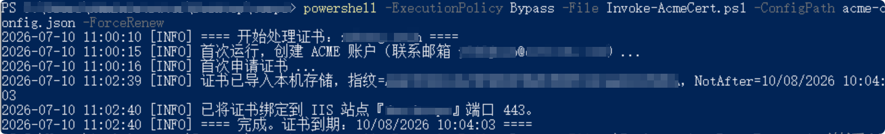
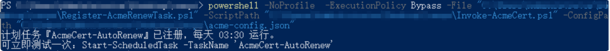

# 免费证书自动续期并部署到 IIS

用 **Posh-ACME + Let's Encrypt + 腾讯云 DNS** 为 Windows Server / IIS 站点自动申请、续期、部署 SSL 证书。

- **永久免费、无限次续期**（Let's Encrypt 无配额限制）。
- **全自动**：DNS-01 验证由 `TencentDNS` 插件自动写入/删除腾讯 DNS 的 TXT 记录，无需人工。
- **纯 PowerShell**，支持泛域名。

> 前提：域名解析托管在腾讯云 DNS/DNSPod（同账号），且服务器能访问 `acme-v02.api.letsencrypt.org`（国内多数可直连）。先测一下：
> ```powershell
> Invoke-WebRequest https://acme-v02.api.letsencrypt.org/directory -UseBasicParsing -TimeoutSec 15
> ```
> 返回 200 即可。

## 文件说明
| 文件 | 作用 |
|---|---|
| `Invoke-AcmeCert.ps1` | 主脚本：安装 Posh-ACME、申请/续期、部署到 IIS（幂等，可反复运行） |
| `acme-config.example.json` | 配置模板 |
| `Register-AcmeRenewTask.ps1` | 注册每日续期计划任务（SYSTEM 身份） |
| `Start-AcmeWeb.ps1` | 证书续期 Web 控制台后端（内置 HttpListener，无第三方依赖） |
| `index.html` | Web 控制台前端页面 |
| `run.bat` / `run.sh` | 一键启动 Web 控制台（`run.bat` 双击即用，自动申请管理员权限） |

## 使用步骤

### 1. 生成腾讯云 API 密钥
到 [DNSPod 密钥页](https://console.dnspod.com/account/token/apikey) 创建 **API 密钥**（`KeyId` + `Secret`）。
> 要的是腾讯云 API 密钥，不是旧版 DNSPod Token。建议用只授权 DNS 权限的子账号密钥。可以用腾讯云的 Kiki 直接操作网页获取对应的SecretId 和 SecretKey

### 2. 填写配置
```powershell
Copy-Item .\acme-config.example.json .\acme-config.json
notepad .\acme-config.json
```
| 字段 | 说明 |
|---|---|
| `TencentKeyId` / `TencentSecret` | 上一步的密钥 |
| `Domains` | 域名数组，如 `["xx.tech"]`；泛域名填 `["xx.tech","*.xx.tech"]` |
| `ContactEmail` | 接收到期提醒的邮箱 |
| `IISSiteName` | IIS 站点名（IIS 管理器里看到的名字，默认 `Default Web Site`） |
| `BindingHost` | https 绑定的主机名，一般与主域名一致；留空则绑定 `*:443` |
| `BindingPort` | 一般 `443` |
| `PfxPassword` | 导入证书用的临时密码，随意 |
| `UseStaging` | 调试设 `true`（LE 测试环境，不受速率限制、浏览器不信任）；正式设 `false` |

### 3. 首次运行（管理员 PowerShell）
首次会自动从 PSGallery 安装 Posh-ACME 模块。
```powershell
powershell -ExecutionPolicy Bypass -File .\Invoke-AcmeCert.ps1 -ConfigPath .\acme-config.json -ForceRenew
```


成功后浏览器访问 `https://你的域名` 验证证书生效。

> 建议先把 `UseStaging` 设 `true` 跑通全流程，再改回 `false` 正式签发，避免踩 LE 正式环境速率限制。

### 4. 挂自动续期
```powershell
powershell -NoProfile -ExecutionPolicy Bypass -File "绝对路径\Register-AcmeRenewTask.ps1" -ScriptPath "绝对路径\Invoke-AcmeCert.ps1" -ConfigPath "绝对路径\acme-config.json"
```

每天检查一次，到续期窗口（默认剩约 30 天）自动续期并重绑 IIS；未到则空跑。

### 5. Web 控制台（可选）
不想敲命令时，用网页查看/操作。后端 `Start-AcmeWeb.ps1` 只用 Windows 内置的 PowerShell + .NET `HttpListener`，**不需要装任何依赖，也不用改 IIS**。

```powershell
# 方式一：双击 run.bat（自动提权并启动，最省事）
# 方式二：管理员 PowerShell 直接启动，浏览器打开 http://localhost:30001/
powershell -ExecutionPolicy Bypass -File .\Start-AcmeWeb.ps1
```

> `run.bat` 会先检查管理员权限，不足时自动弹 UAC 提权；`run.sh` 供 Git Bash / WSL 使用（内部调用 PowerShell）。

页面提供：
- **证书状态**：域名、到期时间、剩余天数（<30 天变黄、<15 天变红）、是否已绑定 IIS、证书指纹。
- **自动续期开关**：显示计划任务当前是「已开启 / 未开启」，拨动开关即可注册/启用或禁用每日续期任务。
- **手动续期**：一键执行 `Invoke-AcmeCert.ps1 -ForceRenew`（立即申请/续期并重绑 IIS）。
- **最近日志**：显示 `acme-work\acme-cert.log` 尾部。

参数：

| 参数 | 说明 |
|---|---|
| `-Port` | 监听端口，默认 `30001` |
| `-BindAddress` | 默认 `localhost`（仅本机）。要局域网访问用 `+` |
| `-StatusCacheSeconds` | 状态缓存秒数，默认 `5`（低配机器可调大以减少查询） |
| `-Install` | 注册开机自启计划任务（SYSTEM），实现「常驻服务」 |
| `-Uninstall` | 停止并删除开机自启任务 |
| `-NoBrowser` | 启动后**不**自动打开浏览器（默认会自动打开；小内存服务器建议加此项） |

```powershell
# 开机自启 + 局域网可访问（需管理员先放行 URL ACL）
netsh http add urlacl url=http://+:30001/ user=Everyone
powershell -ExecutionPolicy Bypass -File .\Start-AcmeWeb.ps1 -Install -BindAddress + -Port 30001
```

> 安全提示：该页面能触发续期、改计划任务，属于高权限操作。默认只监听 `localhost`；若要暴露到局域网/公网，请自行加反向代理鉴权或防火墙限制来源。

## 工作流程
```
Posh-ACME 申请/续期  →  TencentDNS 插件自动写 _acme-challenge TXT
        ↓  Let's Encrypt 校验通过，签发证书
拿到 fullchain.pfx  →  导入本机存储  →  netsh 绑定到 IIS 443（指纹变化才重绑）
```

## 安全要点
- 用只授权 DNS 权限的**子账号**密钥。
- `acme-config.json` 含密钥，收紧 NTFS 权限仅管理员/SYSTEM 可读：
  ```powershell
  icacls .\acme-config.json /inheritance:r /grant:r "Administrators:F" "SYSTEM:F"
  ```
- 私钥只在本机，不外传、不进版本库（已在 `.gitignore` 排除）。

## 常见问题
- **装不上 Posh-ACME**：服务器需能访问 `www.powershellgallery.com`；若不通可离线安装（`Save-Module Posh-ACME` 到本地再拷贝）。
- **DNS 验证失败**：确认域名解析在同一个腾讯云账号的 DNS 下，且 API 密钥有 DNS 权限。
- **调试期反复失败**：先用 `UseStaging=true`，排查好再切正式。
